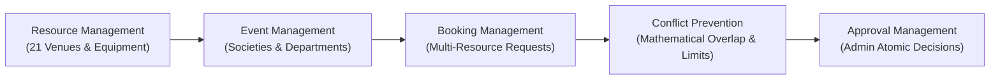

# CampusBook — PGDAV College Infrastructure & Society Event Booking System

[](https://www.python.org/)
[](https://flask.palletsprojects.com/)
[](https://www.sqlalchemy.org/)
[](https://getbootstrap.com/)
[](https://fullcalendar.io/)
[]()

**CampusBook** is an enterprise-grade resource and event booking system custom-built for **PGDAV College (University of Delhi)**. It unifies college infrastructure allocation across 21 venues, manages dynamic audiovisual equipment inventory, supports society and departmental event proposals, and prevents scheduling collisions with a rigorous mathematical conflict engine and atomic administrative approval workflows.

---

## 📑 Table of Contents
- [1. Core Concepts & Architectural Pillars](#-1-core-concepts--architectural-pillars)
- [2. User Roles & Permission Matrix](#-2-user-roles--permission-matrix)
- [3. College Infrastructure & Equipment Catalog](#-3-college-infrastructure--equipment-catalog)
- [4. Conflict Prevention & Business Logic Engine](#-4-conflict-prevention--business-logic-engine)
- [5. UI & Responsive Design Highlights](#-5-ui--responsive-design-highlights)
- [6. Project Structure](#-6-project-structure)
- [7. Quickstart & Installation](#-7-quickstart--installation)
- [8. Pre-Seeded Demo Credentials](#-8-pre-seeded-demo-credentials)
- [9. Automated Verification & Test Suite](#-9-automated-verification--test-suite)
- [10. REST API Reference](#-10-rest-api-reference)

---

## 🏛️ 1. Core Concepts & Architectural Pillars

The application is structured around five fundamental pillars:



1. **Resource Management**: Complete governance of all 21 college venues with configurable capacities, operational hours (09:00 AM – 05:00 PM), and maintenance blackout scheduling.
2. **Event Management**: Departmental and society coordinators organise academic, technical, cultural, and sports events with detailed briefs, requirements, and participant projections.
3. **Multi-Resource Booking Management**: Requesters can reserve multiple facilities (e.g., Seminar Hall + Sports Ground) with independent time intervals within a single event request, alongside shared audiovisual equipment.
4. **Conflict Prevention Engine**: Automatic verification of mathematical time overlaps, equipment inventory limits, maintenance blocks, and college operating hours.
5. **Approval Management**: Centralized administrator decision hub with live conflict detection, atomic concurrency-safe approvals, documented rejections, and audit history.

---

## 👥 2. User Roles & Permission Matrix

The system enforces strict Role-Based Access Control (RBAC):

| Role | View Infrastructure | Live Calendar | Submit Bookings | Cancel Own Bookings | Approve / Reject | Manage Infrastructure & Inventory | User Management & Reports |
|---|:---:|:---:|:---:|:---:|:---:|:---:|:---:|
| **Administrator** | ✅ | ✅ | ✅ | ✅ (Any) | ✅ | ✅ | ✅ |
| **Faculty Member** | ✅ | ✅ | ✅ | ✅ (Own) | ❌ | ❌ | ❌ |
| **Society Coordinator** | ✅ | ✅ | ✅ | ✅ (Own) | ❌ | ❌ | ❌ |
| **Department Coordinator** | ✅ | ✅ | ✅ | ✅ (Own) | ❌ | ❌ | ❌ |
| **Staff Member** | ✅ | ✅ | ✅ | ✅ (Own) | ❌ | ❌ | ❌ |
| **Student** | ✅ | ✅ | ✅ | ✅ (Own) | ❌ | ❌ | ❌ |

---

## 🏢 3. College Infrastructure & Equipment Catalog

### The 21 Infrastructure Resources

| Category | Venues | Count | Capacity |
|---|---|:---:|:---:|
| **Seminar Spaces** | Old Seminar Hall, New Seminar Hall | 2 | 100, 150 |
| **Common Rooms** | Boys Common Room, Girls Common Room | 2 | 60, 60 |
| **Laboratories** | Lab 11, Lab 12, Lab 15 | 3 | 40, 40, 40 |
| **Sports Facilities** | Sports Room, Volleyball Court, Short Ground, Big Ground | 4 | 30, 50, 200, 500 |
| **Departmental Rooms** | Commerce, Sanskrit, Hindi, Mathematics, Computer Science, Statistics, English, History, Political Science, Economics | 10 | 40 each |
| **Total** | | **21** | |

### Dynamic Equipment Inventory
Shared audiovisual equipment is managed as a dynamic concurrent inventory:
- **Projectors**: 5 units
- **Microphones**: 10 units
- **Speakers**: 6 units
- **Laptops**: 20 units
- **Chairs & Tables**: 150 units

### Registered College Societies
- **Hyperion** (Cultural Society)
- **TechSoc** (Technical Society)
- **Raaga** (Music Society)
- **Iris** (Photography Society)
- **Chanakya** (Economics Society)
- **Communique** (Commerce Society)
- **Rudraksh** (Dramatic Society)

---

## 🛡️ 4. Conflict Prevention & Business Logic Engine

### 1. Mathematical Interval Collision Formula
A candidate booking $[S_2, E_2]$ conflicts with an existing booking $[S_1, E_1]$ if and only if:
$$(S_1 < E_2) \land (E_1 > S_2)$$

- **Adjacent Bookings Allowed**: A booking ending at 12:00 PM and another starting at 12:00 PM do **not** overlap.
- **Maintenance Block Check**: Scheduled maintenance blocks also participate in collision checking and immediately prevent booking overlapping intervals.

### 2. Temporal Equipment Concurrency (Sweep-Line Algorithm)
Equipment stock availability is calculated **dynamically across time** using a sweep-line concurrency algorithm, rather than relying on a static counter:
1. All start events contribute $+Q$ allocated units; end events contribute $-Q$ units.
2. Timeline points are sorted chronologically.
3. The peak concurrent allocation is computed throughout the requested interval.
4. If $(\text{Peak Allocation} + \text{Requested Quantity}) > \text{Total Stock}$, the request is rejected with stock breakdown.

### 3. Concurrency-Safe Atomic Approvals
When an administrator reviews a booking:
1. An atomic database transaction locks the resource rows.
2. A re-check for conflicting approved bookings is conducted.
3. If another administrator has concurrently approved an overlapping booking, the second approval safely fails with an informative error message. Double-booking race conditions are mathematically prevented.

### 4. Operational Boundaries
- **Operating Hours**: Requests are restricted to **09:00 AM – 05:00 PM** (configurable in System Settings).
- **Single-Day Scope**: Bookings cannot span overnight across multiple dates.
- **Advance Notice**: Submissions require minimum advance notice (default 24 hours).

---

## 🎨 5. UI & Responsive Design Highlights

### Clean, Direct Login Flow
- **Root URL (`/`)**: Directly routes unauthenticated users to `/auth/login` and logged-in users straight to their dashboard.
- **Demo Access `(i)` Modal**: Removed cluttered demo banners from the login card. Clicking the discreet `(i) Demo Access` button opens a clean modal with 1-click credential auto-fill for Admin, Coordinator, Faculty, and Student roles.

### Scroll-Free, Modern Live Schedule (FullCalendar 6)
- **Native Scroll-Free (`height: 'auto'`)**: The calendar expands naturally with zero internal scrollbars.
- **Strict Box Containment**: Events use `box-sizing: border-box`, `max-width: 100%`, and text truncation with ellipsis (`...`). Event pills stay strictly within their day cells without leaking or overflowing.
- **Soft Modern Accent Cards**:
  - **Confirmed**: Soft emerald background (`#ecfdf5`), dark green text (`#065f46`), left emerald border (`#10b981`).
  - **Pending**: Soft amber background (`#fffbeb`), dark amber text (`#92400e`), left amber border (`#f59e0b`).
  - **Maintenance**: Soft rose background (`#fef2f2`), dark red text (`#991b1b`), left red border (`#ef4444`).
- **Operating Hours Focus**: Week and Day views automatically focus on 08:00 AM – 06:00 PM.

### Mobile-First Layout
- **Short Mobile Footer**: Ultra-compact 2-line footer (`py-2`, 100dvh viewport support) that keeps the page clean and unobtrusive.
- **Mobile Bottom Navigation Dock**: For authenticated users on mobile devices, a native app dock provides one-tap access to **Home**, **Venues**, **+ Book** (elevated action button), **Schedule**, and **Bookings**.
- **Touch-Scrollable Pills**: Category filters can be swiped horizontally on touchscreens.

---

## 📁 6. Project Structure

```
CollegeSync/
├── config.py                       # Configuration environments (Dev, Test, Prod)
├── run.py                          # Flask application launcher & auto-seed check
├── seed.py                         # Seeds all 21 venues, equipment, departments & users
├── requirements.txt                # Python dependencies
├── README.md                       # System documentation
├── .gitignore                      # Git ignore patterns
│
├── instance/                       # Flask instance directory
│   └── campusbook.db               # SQLite database
│
├── app/
│   ├── __init__.py                 # Application factory & blueprint registration
│   ├── extensions.py               # SQLAlchemy & Flask-Login singletons
│   ├── utils.py                    # Session CSRF tokens & role-based route decorators
│   │
│   ├── models/                     # SQLAlchemy Models
│   │   ├── department.py           # 10 College Academic Departments
│   │   ├── society.py              # 7 College Societies & Memberships
│   │   ├── user.py                 # Users, passwords (pbkdf2:sha256) & RBAC
│   │   ├── resource.py             # 21 Infrastructure Venues & Maintenance Blocks
│   │   ├── equipment.py            # Dynamic Equipment Inventory & Requests
│   │   ├── event.py                # Event details, categories & expected attendees
│   │   ├── booking.py              # BookingRequest, BookingResource, ApprovalHistory
│   │   └── notification.py         # In-app notifications
│   │
│   ├── services/                   # Pure Business Logic Layer
│   │   ├── availability_service.py # Time-interval overlap & operating hours validator
│   │   ├── equipment_service.py    # Temporal sweep-line equipment concurrency
│   │   ├── booking_service.py      # Multi-resource booking transaction engine
│   │   ├── approval_service.py     # Race-condition safe atomic approval engine
│   │   └── notification_service.py # User notification dispatcher
│   │
│   ├── routes/                     # Modular Flask Blueprints
│   │   ├── auth.py                 # /auth/login, /auth/register, /auth/logout, /auth/profile
│   │   ├── main.py                 # Root redirect, /dashboard, /calendar
│   │   ├── resources.py            # /resources catalog & venue availability
│   │   ├── bookings.py             # /bookings multi-resource wizard & booking detail
│   │   ├── admin.py                # /admin dashboard, booking reviews, venues, equipment
│   │   ├── api.py                  # /api/calendar/events, /api/resources, /api/reports
│   │   └── notifications.py        # /notifications in-app alerts
│   │
│   ├── static/
│   │   └── css/style.css           # Clean collegiate stylesheet with mobile dock rules
│   │
│   └── templates/                  # Jinja2 Templates
│       ├── base.html               # Responsive navigation, sticky footer, mobile app dock
│       ├── auth/                   # Sign in with (i) demo modal, registration, profile
│       ├── calendar/               # Scroll-free live schedule with interactive filters
│       ├── resources/              # Venue catalog & detail view
│       ├── bookings/               # 3-step booking wizard, history, cancellation
│       ├── dashboard/              # Role-specific dashboard views
│       ├── admin/                  # Decision console, reports, inventory & settings
│       └── notifications/          # In-app alerts list
│
└── tests/                          # 14 Automated Unit & Concurrency Tests
    ├── test_auth.py                # Authentication, hashing & access control
    ├── test_bookings.py            # Multi-resource bookings & cancellation
    ├── test_conflicts.py           # Interval collision math & maintenance blocks
    ├── test_approvals.py           # Approval workflow & concurrent race prevention
    └── test_equipment.py           # Sweep-line peak equipment concurrency
```

---

## 🚀 7. Quickstart & Installation

### Prerequisites
- Python 3.10+ (tested on Python 3.10, 3.11, 3.12, 3.13)
- Windows / macOS / Linux

### 1. Clone & Set Up Virtual Environment
```bash
# Navigate to project folder
cd CollegeSync

# Create virtual environment
python -m venv venv

# Activate virtual environment
# Windows:
venv\Scripts\activate
# macOS/Linux:
source venv/bin/activate
```

### 2. Install Dependencies
```bash
pip install -r requirements.txt
```

### 3. Initialize & Seed Database
```bash
python seed.py
```
> [!NOTE]
> `seed.py` creates `instance/campusbook.db`, populates all **21 venues**, **5 equipment types**, **10 academic departments**, **7 college societies**, system settings, and default test accounts.

### 4. Run Development Server
```bash
python run.py
```
Open **[http://127.0.0.1:5000](http://127.0.0.1:5000)** in your web browser.

---

## 🔑 8. Pre-Seeded Demo Credentials

You can use these accounts to log in, or click **`(i) Demo Access`** on the sign-in page to auto-fill them with one click:

| Role | Email | Password | Affiliation |
|---|---|---|---|
| **Administrator** | `admin@pgdav.du.ac.in` | `admin123` | College Administration |
| **Society Coordinator** | `coord.tech@pgdav.du.ac.in` | `coord123` | TechSoc (Technical Society) |
| **Faculty Member** | `faculty@pgdav.du.ac.in` | `faculty123` | Department of Commerce |
| **Department Coordinator** | `coord.cs@pgdav.du.ac.in` | `deptcoord123` | Department of Computer Science |
| **Student** | `student@pgdav.du.ac.in` | `student123` | B.Sc. Computer Science |

---

## 🧪 9. Automated Verification & Test Suite

The test suite validates the entire business logic and concurrency requirements with **14 automated tests**:

```bash
python -m unittest discover tests
```

### Summary of Test Coverage:
1. `test_user_registration_and_hashing`: Verifies secure password hashing and account setup.
2. `test_login_success_and_failure`: Tests authentication and session management.
3. `test_student_cannot_access_admin_dashboard`: Enforces RBAC route protections.
4. `test_create_single_resource_booking`: Verifies standard single-venue reservation requests.
5. `test_create_multi_resource_booking`: Confirms multi-room booking requests within a single event.
6. `test_cancel_booking_releases_resources`: Confirms booking cancellation frees up slots.
7. `test_adjacent_time_slots_allowed`: Proves that consecutive back-to-back bookings (e.g. 10:00–12:00 and 12:00–14:00) do **not** conflict.
8. `test_overlapping_slot_with_approved_booking_rejected`: Verifies $(S_1 < E_2) \land (E_1 > S_2)$ collision detection.
9. `test_booking_during_maintenance_blocked`: Validates scheduled blackout enforcement.
10. `test_outside_operating_hours_blocked`: Enforces 09:00 AM – 05:00 PM operating constraints.
11. `test_approve_booking_flow`: Tests standard administrator approval and notification dispatch.
12. `test_reject_booking_flow`: Validates administrator rejection with documented reason.
13. `test_concurrent_approval_race_condition`: Simulates two administrators attempting to approve overlapping bookings simultaneously; guarantees one commits and the second is safely blocked.
14. `test_equipment_concurrency_allocation`: Verifies sweep-line peak concurrent equipment stock checking across overlapping intervals.

---

## 🔌 10. REST API Reference

| Endpoint | Method | Description | Parameters |
|---|:---:|---|---|
| `/api/calendar/events` | `GET` | Returns FullCalendar JSON events | `start`, `end`, `category_id`, `resource_id` |
| `/api/resources` | `GET` | List all active venues | `category_id` |
| `/api/resources/<id>/availability` | `GET` | Checks venue availability for given window | `date`, `start_time`, `end_time` |
| `/api/equipment/availability` | `GET` | Returns peak concurrent stock remaining | `start_at`, `end_at`, `equipment_id` |
| `/api/reports/charts` | `GET` | Aggregated metrics for Chart.js dashboards | Admin session required |

---

## 📄 License & Credits
Developed for **PGDAV College, University of Delhi**. Built with Python, Flask, Bootstrap 5, and FullCalendar.
All rights reserved © 2026.
